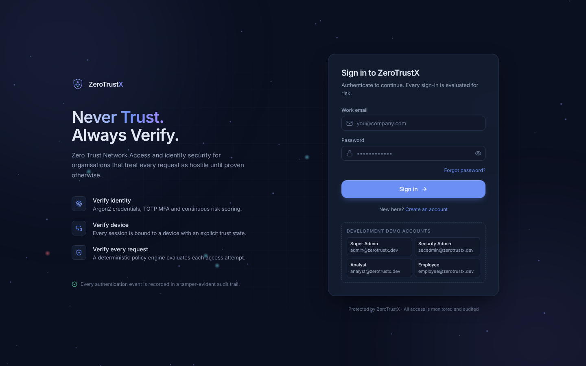
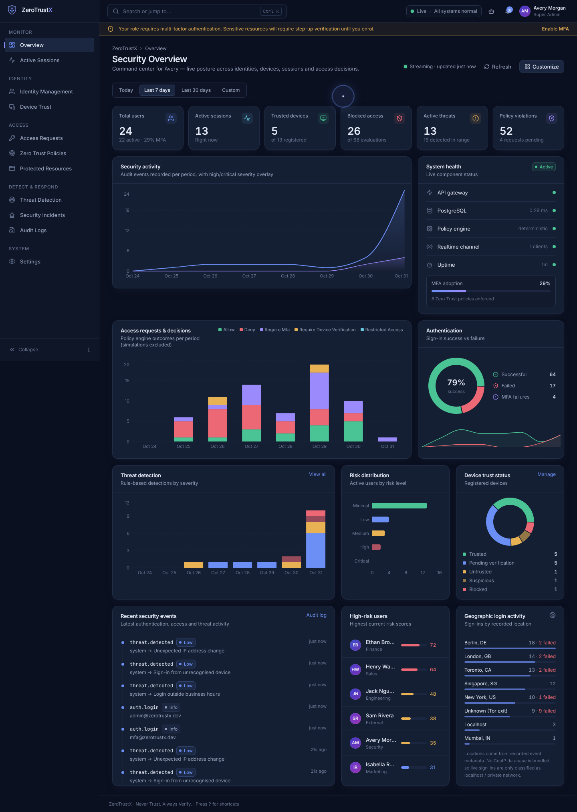
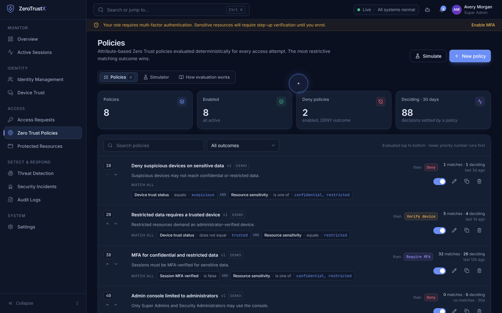
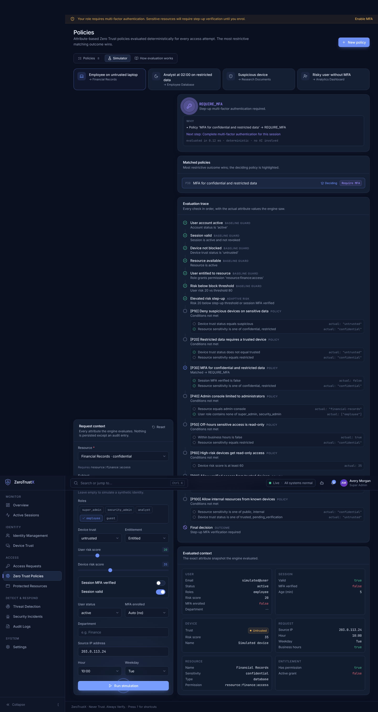
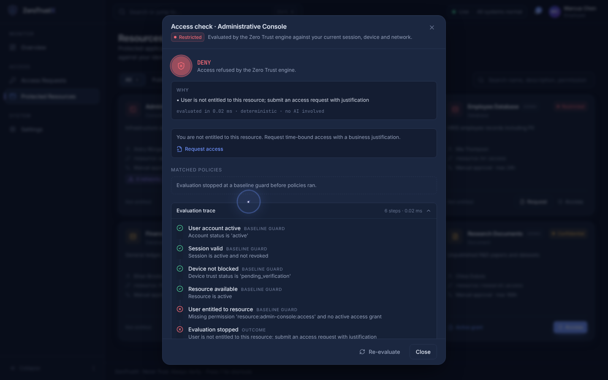
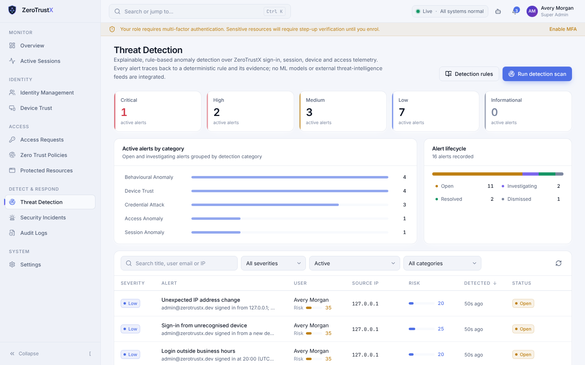

# ZeroTrustX

**Never Trust. Always Verify.**

ZeroTrustX is a full-stack Zero Trust Network Access (ZTNA) and identity security platform. A deterministic
policy engine checks every access attempt to a protected resource against identity, role, device trust, MFA state,
session validity, network, time, resource sensitivity and risk. Every decision comes with an explanation and is
recorded in a tamper-evident audit trail.

| Layer | Technology |
| --- | --- |
| Frontend | React 18, TypeScript, Vite 6, Tailwind CSS 3, Framer Motion, TanStack Query 5, React Router 6, React Hook Form + Zod, Recharts, Axios, Lucide |
| Backend | Python 3.13, FastAPI, SQLAlchemy 2, Pydantic 2, Alembic, PyJWT, Argon2 (argon2-cffi), PyOTP, Fernet (cryptography), WebSockets |
| Database | PostgreSQL 16 |
| Tooling | Docker / Docker Compose, pytest, Vitest + Testing Library, Playwright (screenshots/E2E checks) |

---

## Contents

1. [Quick start (Docker)](#quick-start-docker)
2. [Local development](#local-development)
3. [Demo accounts](#demo-accounts-development-only)
4. [Feature overview](#feature-overview)
5. [Architecture & project structure](#architecture--project-structure)
6. [Zero Trust policy engine](#zero-trust-policy-engine)
7. [Security model](#security-model)
8. [API](#api)
9. [Testing](#testing)
10. [Screenshots](#screenshots)
11. [Known limitations](#known-limitations)

---

## Quick start (Docker)

```bash
cp .env.example .env
```

```bash
docker compose up --build
```

- Web app: http://localhost:8080 (nginx serves the SPA and proxies `/api` and the WebSocket to the API)
- API docs (Swagger UI): http://localhost:8000/api/docs · ReDoc: http://localhost:8000/api/redoc
- On start, the backend container waits for PostgreSQL, runs `alembic upgrade head`, bootstraps roles/permissions, and
  loads demo data when `SEED_DEMO_DATA=true`.

To reset the database:

```bash
docker compose down -v
```

## Local development

Prerequisites: Python 3.12+ (tested on 3.13), Node.js 20+ (tested on 22), PostgreSQL 16.

### 1. Database

```bash
createuser -P zerotrustx        # password: zerotrustx_dev (or update DATABASE_URL)
```

```bash
createdb -O zerotrustx zerotrustx
```

```bash
createdb -O zerotrustx zerotrustx_test   # used by the backend test suite
```

### 2. Backend

```bash
cd backend
python -m venv .venv && . .venv/bin/activate
pip install -r requirements-dev.txt
cp ../.env.example .env          # adjust DATABASE_URL if needed
```

```bash
alembic upgrade head             # create schema (+ append-only audit trigger)
```

```bash
python -m app.db.seed            # roles, permissions, settings + demo data
```

```bash
uvicorn app.main:app --reload --port 8000
```

`python -m app.db.seed --no-demo` bootstraps only the RBAC catalogue and org settings. This mode is safe for production.
To wipe and reload demo data, run `alembic downgrade base && alembic upgrade head && python -m app.db.seed`.

### 3. Frontend

```bash
cd frontend
npm install
npm run dev                      # http://localhost:5173 (proxies /api + WebSocket to :8000)
```

Production build: `npm run build` (outputs `frontend/dist`).

## Demo accounts (development only)

Running `python -m app.db.seed` without `--no-demo` creates these accounts. Demo loading is refused when `APP_ENV=production`.
Every seeded record has `is_demo = true`, and the UI marks it with a **DEMO** tag, so you can tell demo data from real runtime events.

| Role | Email | Password |
| --- | --- | --- |
| Super Admin | `admin@zerotrustx.dev` | `SuperAdmin!2026` |
| Security Administrator | `secadmin@zerotrustx.dev` | `SecAdmin!2026` |
| Security Analyst | `analyst@zerotrustx.dev` | `Analyst!2026x` |
| Employee | `employee@zerotrustx.dev` | `Employee!2026` |
| Guest | `guest@zerotrustx.dev` | `GuestUser!2026` |
| Security Admin **with MFA** | `mfa@zerotrustx.dev` | `MfaDemo!2026x` |
| All other seeded users | `*.*@zerotrustx.dev` | `ZeroTrust!Demo1` |

The MFA demo account uses the well-known example TOTP secret `JBSWY3DPEHPK3PXP`. Add it to any authenticator app, or
generate a code with `python -c "import pyotp;print(pyotp.TOTP('JBSWY3DPEHPK3PXP').now())"`. Some seeded users are
suspended, deactivated or high-risk on purpose, so you can see those flows.

Seed volume: 24 users (1 super admin, 5 security admins, 2 analysts, 15 employees, 1 guest), 10 devices,
8 policies, 6 protected resources, 20 access requests, 32 audit events, 10 threat alerts, 3 incidents,
~260 sign-in events, ~190 engine-evaluated access decisions and 25 sessions (10 active).

## Feature overview

**Authentication & sessions**
- Registration, login, forgot/reset password, MFA verification, unauthorized (403), session-expired and 404 pages.
- Argon2id password hashing and a configurable password policy, enforced on the server with a live strength meter in the UI.
- JWT access tokens (15 min) are held in memory only. Refresh tokens are opaque, HttpOnly, `SameSite=Strict` cookies scoped to `/api/v1/auth`. They are **rotated on every use**, and **reuse is detected**: replaying an old refresh token revokes the session and raises a high-severity alert.
- Server-side sessions: every request re-validates the session, so revocation takes effect immediately. Sessions have an absolute timeout and an idle timeout. Users can log out of all devices.
- Failed-login tracking, account lockout, per-IP rate limiting, login history.

**Multi-factor authentication**
- TOTP enrolment with a QR code (SVG) and a manual secret. Secrets are encrypted at rest with Fernet.
- 10 single-use recovery codes, stored as keyed hashes. Codes can be regenerated.
- TOTP replay protection (a time step cannot be reused). Disabling MFA requires both the password and a code.
- Step-up MFA: when a policy returns `REQUIRE_MFA`, the user verifies inline and the session becomes MFA-verified.

**Identity & Access Management**
- User CRUD, suspension, deactivation, activation, unlock, access reset, role assignment, risk recalculation, authentication history.
- Roles: Super Admin, Security Administrator, Analyst, Employee, Guest. 32 fine-grained permissions, including resource entitlements.
- RBAC is enforced in the FastAPI dependency `require(...)` on every protected endpoint. Denied API calls are themselves audited.
- Privilege-escalation protection: you can't assign a role at or above your own level, manage peers or superiors, change your own roles, or grant permissions you don't hold. Super Admin permissions are immutable.

**Device trust.** Devices have five states: trusted, untrusted, suspicious, blocked and pending verification. Every state change is kept in a trust history. Blocking a device revokes its sessions immediately. Devices are registered automatically on first sign-in or manually by an administrator.

**Zero Trust policy engine.** See [the section below](#zero-trust-policy-engine). It covers policy CRUD, priorities and reorder, enable/disable, a condition builder, execution history, change history, and a simulator that also accepts draft policies.

**Access requests.** Users submit a request with a business justification, and the policy engine evaluates the requester's posture right away:
- **Auto-reject** when the engine denies the request.
- **Auto-approve** when the engine allows it and the resource doesn't require approval.
- **Manual review** otherwise.

The approval flow enforces separation of duties: you can't approve your own request. Grants are time-boxed and expire automatically. Requests move through pending, approved, rejected, expired and revoked, and each request has a full audit trail.

**Real-time session monitoring.** Shows live sessions with user, device, IP, MFA state, risk, last activity, and unusual patterns such as concurrent IPs. Admins can terminate sessions, which revokes their tokens. Updates arrive over an authenticated WebSocket.

**Threat detection & incidents.** Eleven explainable detection rules:
- brute force
- password spraying
- repeated MFA failures
- multiple access denials
- off-hours login
- new device
- untrusted-device login
- IP change
- session-token IP change
- refresh-token reuse
- abnormal access frequency

Risk scoring is rule-based with configurable weights. Incidents follow a status workflow: open → investigating → contained → resolved → closed. Analysts can assign investigators and add notes, and alerts can be escalated into incidents.

**Audit logging.** Records 40+ action types. You can search, filter, view details and export to CSV (with formula-injection protection). Logs are append-only: a PostgreSQL trigger blocks UPDATE, DELETE and TRUNCATE. They are also SHA-256 hash-chained, and an integrity check verifies the whole chain.

**Dashboard.** Covers:
- metrics
- security activity
- access decisions
- authentication success vs failure
- threats by severity
- risk distribution
- device trust
- recent events
- high-risk users
- login locations
- live system health

Date ranges: Today, 7 days, 30 days or a custom range. Every number comes from the database. You can choose which widgets to show.

**Security Assistant (advisory).** A local, deterministic, rule-based assistant. It explains decisions, summarizes incidents, explains audit events, interprets risk scores and reviews recent activity. It needs no API keys. All output is labelled advisory, and the assistant has no endpoints that change state. The provider interface (`backend/app/assistant/provider.py`) leaves room for an optional AI provider later.

**UX.**
- Collapsible sidebar and mobile navigation.
- Ctrl/⌘+K command palette with global search, `g`-chord shortcuts (`g u`, `g p`, …) and `?` for help.
- Notification center, system status indicator, and dark / light / system themes.
- Toasts, confirmation dialogs, skeleton loaders, empty states and animated decision indicators.
- A **fluid cursor**: a precise dot plus an interpolated, velocity-stretched ring with a blue-lavender trail. It expands over interactive elements and ignores pointer events. It is disabled automatically on touch or coarse pointers and when reduced motion is preferred, and you can turn it off in the profile menu.

## Architecture & project structure

```
zerotrustx/
├── docker-compose.yml          # postgres + api + nginx-served SPA
├── .env.example
├── docs/FRONTEND_CONVENTIONS.md
├── backend/
│   ├── alembic/versions/       # 0001 schema, 0002 append-only audit trigger
│   ├── app/
│   │   ├── main.py             # app factory, CORS, security headers, sweeper task
│   │   ├── core/               # config, security (argon2/jwt/fernet/totp), deps (authn/authz), rate limiting
│   │   ├── db/                 # engine/session, bootstrap (RBAC catalogue), seed (demo data)
│   │   ├── models/             # SQLAlchemy models (24 tables) + enums
│   │   ├── schemas/            # Pydantic request/response models
│   │   ├── policy_engine/      # engine.py (pure, deterministic), fields.py (attribute/operator catalogue)
│   │   ├── services/           # audit, access (PEP<->engine), risk, threats, sessions, devices, notify, org
│   │   ├── api/routes/         # auth, mfa, users, devices, sessions, policies, resources, access_requests,
│   │   │                       # threats (+incidents), audit, dashboard, misc (settings/search/notifications), assistant
│   │   ├── ws/                 # authenticated WebSocket endpoint + commit-aware event bus
│   │   └── assistant/          # advisory rule-based assistant (provider interface)
│   └── tests/                  # pytest suite (PostgreSQL)
└── frontend/
    └── src/
        ├── components/         # ui/ (design system), layout/, security/, charts/, brand/, cursor/
        ├── context/            # Auth, Realtime (WebSocket), Toast, Preferences
        ├── layouts/            # AppLayout, AuthLayout
        ├── pages/              # auth/* and app/* (one file per module)
        ├── routes/             # guards
        ├── services/api.ts     # axios client, refresh single-flight, error normalisation
        ├── hooks/, types/, utils/, test/
```

**Database** (PostgreSQL, normalized, UUID keys, FK constraints, check constraints, indexes). Tables:
`users`, `roles`, `permissions`, `role_permissions`, `user_roles`, `devices`, `device_trust_history`, `mfa_configs`,
`recovery_codes`, `password_reset_tokens`, `sessions`, `security_events`, `protected_resources`, `policies`,
`policy_conditions`, `access_decisions`, `access_decision_policies` (normalized policy execution history),
`access_requests`, `threat_alerts`, `incidents`, `incident_notes`, `audit_logs`, `notifications`, `organization_settings`.

**Real-time.** Services queue events on the SQLAlchemy session. Events are broadcast only **after the transaction commits** and are dropped on rollback. Delivery is scoped by audience: a specific user, or holders of a specific permission.

Event types:
- session created / revoked
- device updated
- access decision
- access request updated
- threat created / updated
- incident updated
- notification
- audit created

The first frame a client sends must carry the access token, so tokens never appear in URLs. The server re-validates the session periodically, and sockets for revoked sessions are closed. The frontend maps each event to TanStack Query invalidations.

## Zero Trust policy engine

`backend/app/policy_engine/engine.py` is a pure function of *(context, policies, org thresholds)*. It never calls external services or AI models.

1. **Baseline guards.** These can't be overridden by policies, and evaluation stops on the first failure:
   - account is active
   - session is valid
   - device is not blocked
   - resource is enabled
   - user is entitled, through a role permission or an approved, unexpired access grant
   - resource IP allowlist
   - resource access window
   - user risk is below the **block threshold**
2. **Adaptive risk.** If risk is at or above the **MFA threshold** and the session isn't MFA-verified, the candidate outcome is `REQUIRE_MFA`.
3. **Administrator policies.** Enabled policies are evaluated in priority order. A condition has the form *attribute · operator · value*, and conditions are combined with `all` or `any`.
   - Attributes: user role, risk, department, MFA enrolment; session MFA, session age; device trust, device risk; source IP (CIDR); hour, weekday, business hours; resource sensitivity, resource, resource type.
   - Operators: eq, neq, in, not_in, gt/gte/lt/lte, between, contains, not_contains, in_cidr, not_in_cidr, is_true, is_false.
4. **Combination: deny-overrides.** When several outcomes apply, the most restrictive one wins: `DENY` > `REQUIRE_DEVICE_VERIFICATION` > `REQUIRE_MFA` > `RESTRICTED_ACCESS` > `ALLOW`. If no policy matches, the organisation **default action** applies, which is **DENY** by default.

Each evaluation returns:
- the decision and the reasons behind it
- required next actions
- a full **trace** listing every guard, every policy and every condition, with the actual attribute value that was compared
- the matched and deciding policies

Evaluations are persisted with a context snapshot. Decisions can come from three places: the resource gateway (`POST /resources/{id}/access`), access requests, and the simulator. The simulator doesn't persist results.

## Security model

- **Secrets come from the environment.** The API refuses to start in production with the default dev secrets, or with `EXPOSE_DEV_RESET_TOKENS` enabled. `.env` is git-ignored, and `.env.example` documents every variable.
- **Credentials.**
  - Passwords are hashed with Argon2id. Hashes are re-hashed when parameters change.
  - Unknown users are run through a dummy hash, so response timing doesn't reveal whether an account exists. Login and forgot-password responses are generic for the same reason.
  - Refresh, reset and recovery tokens are stored as HMAC-SHA256 hashes. TOTP secrets are encrypted with Fernet.
- **Tokens.**
  - JWTs are checked for issuer, expiry and type, so an `mfa_pending` token can't be used as an access token.
  - Every access token is bound to a server-side session that is checked on each request.
  - Refresh tokens rotate on every use, with reuse detection. A 30-second grace window lets a token that was rotated by an interrupted request (for example a page reload mid-refresh) rotate once more instead of revoking the session; replay after that window revokes the session and raises an alert.
- **Authorization.** Permissions are checked server-side on every endpoint, with the privilege-escalation guards described above. The frontend hides controls only for UX.
- **Input validation.** Pydantic schemas with strict patterns and lengths. Validation errors use a uniform shape. SQLAlchemy uses parameterized queries throughout.
- **Transport and browser hardening.**
  - CORS is limited to configured origins, and WebSocket Origin is checked.
  - Security headers (nosniff, frame-deny, referrer policy, permissions policy, `Cache-Control: no-store` on API responses).
  - nginx sends a CSP.
  - Cookie `Secure` and `SameSite` are configurable.
- **Rate limiting** on login, MFA, registration, reset and refresh.
- **Audit.** The audit trail is append-only, enforced by a database trigger, and hash-chained. Failed authorization attempts are audited too.

## API

Interactive documentation is generated by FastAPI at `/api/docs` (Swagger) and `/api/redoc`, and the schema is at `/api/openapi.json`. There are about 83 endpoints under `/api/v1`. All list endpoints support `page`, `page_size` (≤100), `sort`, `order` and `q`, plus resource-specific filters.

| Area | Key endpoints |
| --- | --- |
| Auth | `POST /auth/register`, `/auth/login`, `/auth/mfa/verify`, `/auth/refresh`, `/auth/logout`, `/auth/logout-all`, `/auth/step-up`, `/auth/forgot-password`, `/auth/reset-password`, `/auth/change-password`, `GET/PATCH /auth/me`, `GET /auth/me/login-history` |
| MFA | `GET /mfa/status`, `POST /mfa/setup`, `/mfa/enable`, `/mfa/disable`, `/mfa/recovery-codes` |
| Identity | `GET/POST /users`, `GET/PATCH /users/{id}`, `PUT /users/{id}/roles`, `POST /users/{id}/suspend|deactivate|activate|unlock|reset-access|recalculate-risk`, `GET /users/{id}/login-history`, `GET /roles`, `GET /permissions`, `PUT /roles/{id}/permissions` |
| Devices | `GET/POST /devices`, `GET /devices/summary`, `GET /devices/mine`, `GET/PATCH/DELETE /devices/{id}`, `POST /devices/{id}/trust` |
| Sessions | `GET /sessions`, `/sessions/stats`, `/sessions/mine`, `/sessions/{id}`, `POST /sessions/{id}/terminate`, `/sessions/expire-stale` |
| Policies | `GET/POST /policies`, `GET /policies/fields`, `POST /policies/reorder`, `POST /policies/simulate`, `GET/PUT/DELETE /policies/{id}`, `POST /policies/{id}/toggle` |
| Resources | `GET/POST /resources`, `GET/PUT/DELETE /resources/{id}`, `POST /resources/{id}/access` (policy enforcement point) |
| Access requests | `GET/POST /access-requests`, `GET /access-requests/summary`, `GET /access-requests/{id}`, `POST …/approve`, `…/reject`, `…/revoke` |
| Threats | `GET /threats`, `/threats/summary`, `/threats/rules`, `GET/PATCH /threats/{id}`, `POST /threats/scan`, `POST /threats/{id}/escalate` |
| Incidents | `GET/POST /incidents`, `GET /incidents/assignees`, `GET/PATCH /incidents/{id}`, `POST /incidents/{id}/notes` |
| Audit | `GET /audit-logs`, `/audit-logs/facets`, `/audit-logs/verify`, `/audit-logs/export` (CSV), `/audit-logs/{id}` |
| Platform | `GET /dashboard/overview`, `GET /notifications`, `POST /notifications/{id}/read`, `/notifications/read-all`, `GET/PUT /settings/organization`, `GET /settings/timezones`, `GET /system/status`, `GET /search` |
| Assistant | `GET /assistant/decisions/{id}`, `/assistant/incidents/{id}`, `/assistant/audit/{id}`, `/assistant/users/{id}/risk`, `/assistant/activity`, `POST /assistant/ask` |
| Real-time | `WS /api/v1/ws`. The first frame must be `{"type":"auth","token":"<access token>"}`. |

## Testing

Backend tests run against a real PostgreSQL database, `zerotrustx_test`, or the database named in `TEST_DATABASE_URL`. The suite migrates the schema from scratch.

```bash
cd backend && .venv/bin/pytest
```

Frontend unit and workflow tests use Vitest, jsdom and Testing Library:

```bash
cd frontend && npm test
```

```bash
cd frontend && npx tsc -b --noEmit && npm run build
```

See [Test results](#test-results) for the latest run.

### Test results (latest run, 2026-10-31)

| Suite | Result |
| --- | --- |
| Backend pytest (PostgreSQL 16) | **84 passed** — engine unit tests (20), auth & sessions incl. refresh rotation/reuse/grace, lockout, rate limiting, reset flow (16), MFA incl. replay & recovery codes (6), RBAC & privilege escalation (11), gateway/policy/access-request workflow (11), devices & sessions (7), audit immutability/export/chain + threats/incidents/dashboard/assistant (10), WebSocket auth & scoping (3) |
| Frontend Vitest | **14 passed** — login validation, MFA redirect, error display, permission guard, OTP paste, decision trace, password policy, formatters |
| TypeScript | `tsc -b --noEmit` clean |
| Production build | `vite build` succeeds |
| Headless E2E (Playwright/Chromium) | 24/24 steps passed, 0 console/page errors: TOTP MFA login with the demo secret, every page as Super Admin, drawers, simulator, light theme + reload (session restored via refresh cookie), employee gateway check, analyst mobile view (no horizontal overflow at 390px) |

In addition, each module was exercised end to end with real mutations during development (create/suspend users, trust/block devices, terminate sessions, create/reorder/toggle/delete policies, submit → approve access requests with gateway re-check, step-up MFA, escalate alerts to incidents and drive incidents to closed, audit export and integrity verification, MFA enrolment/disable on a throwaway account).

## Screenshots

Captured with headless Chromium against the running stack (`docs/screenshots/`):

| | |
| --- | --- |
|  |  |
|  |  |
|  |  |

Also included: MFA verification, identity, roles, user detail, devices + drawer, access requests, evaluation model, resources, sessions, threat drawer, incidents, incident detail, audit logs, settings (security, organization) and a mobile view.

## Known limitations

These are stated plainly to avoid overstating what the platform does:

- **No endpoint agent.** A device is a browser-generated identifier (sent as the `X-Device-Id` header) or an admin-registered record. OS, patch level, disk encryption and EDR status are **not** verified, and OS and browser come from the User-Agent, which the client can spoof. Device trust is an administrative attestation.
- **No GeoIP database.** Live sign-ins are only classified as localhost or private network. The city and country values on the dashboard come from seeded demo data.
- **Threat detection is rule-based.** There is no machine learning and no integration with external threat-intelligence feeds.
- **No email delivery.** Password-reset links are written to the API log. For local testing, `EXPOSE_DEV_RESET_TOKENS=true` also returns the link in the API response, and this is refused in production.
- **Single-process state.** The rate limiter and the WebSocket connection registry are in-process. Running multiple API replicas would require Redis, for both rate limiting and pub/sub. The background sweeper (session and grant expiry) also runs in-process every 60 seconds.
- **Gateway is decision-only.** The resource gateway returns a decision and the resource URL. It doesn't proxy traffic to the protected application, the way a production ZTNA connector would.
- **Assistant is advisory and local.** It is deterministic and rule-based. No LLM provider is implemented, only the interface for one.
- **Docker Compose not run here.** The Compose setup was validated with `docker compose config`, but couldn't be run end-to-end in the build environment because no Docker daemon was available. The stack was tested with a native PostgreSQL 16, Uvicorn and Vite.
- **Smaller API gaps found during review:**
  - Alerts can only be linked to an incident when the incident is created; an existing alert can't be attached to an existing incident.
  - `/sessions/mine` returns the latest 25 sessions without paging, and the device detail view caps its embedded history lists (20–25 rows).
  - Every simulator run (including draft-policy tests) writes an audit entry.
  - Each browser profile is a separate "device", so automated or headless sign-ins create new pending devices.
